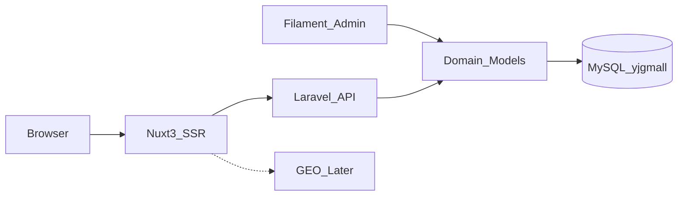

# 有机硅商城 · 正式技术规划（质量优先）

> 原则：Destoon / 线上站只作需求与交互对照；业务用新代码实现。不求快，求稳、求复刻准、求可维护。GEO 后期对接，本期只做结构预留。

## 1. 目标

对照 [https://www.yjgmall.com/](https://www.yjgmall.com/) 完成：

- 门户、搜索、供应、采购、企业库、商城、资讯
- 会员登录注册、商务中心（供需自管、订单、消息、资料）
- 运营后台（审核、分类、广告、资讯、订单、会员）
- 视觉与信息架构高度贴近线上（色板、顶栏、搜索、三栏首页、分类导航）
- 代码分层清晰，便于后续接 GEO 与真实支付宝

## 2. 最终技术选型（已定）

| 层 | 选型 | 理由 |
|----|------|------|
| 运行时 | PHP 8.3 | 现代、稳定 |
| API / 领域 | Laravel 11 | 鉴权、校验、队列、后台成熟 |
| 运营后台 | Filament 3（`/admin`） | 审核运营效率高，与前台解耦 |
| 前台 | **Nuxt 3 + Vue 3（SSR）** | 你要的 Vue；SSR 利于后续 GEO/SEO |
| 鉴权 | Laravel Sanctum（Cookie/SPA 或 Token） | Nuxt 调 API 标准做法 |
| DB | MySQL `yjgmall` | 沿用已有库与迁移 |
| 样式 | 独立设计 Token（CSS 变量）+ 组件化 | 精复刻线上橙/深色导航，不用默认紫系 AI 风 |

### 仓库形态

```
有机硅商城/
  yjgmall-next/     # Laravel API + Filament（后端唯一真相）
  yjgmall-web/      # Nuxt 3 SSR 前台（用户可见站点）
  DESTOON_.../      # 只读对照，不改业务
```

Blade 前台保留但不作为交付主站；交付入口改为 Nuxt。

## 3. 架构



- **读多写少的公开页**：Nuxt `useAsyncData` / `useFetch` 在服务端拉 API，输出真实 HTML。
- **会员写操作**：Nuxt 客户端调 API（发布、购物车、下单）。
- **后台**：继续 Filament，不进 Nuxt。

## 4. API 约定

前缀：`/api/v1`

| 方法 | 路径 | 说明 |
|------|------|------|
| GET | `/home` | 首页聚合 |
| GET | `/sell` `/sell/{id}` | 供应 |
| GET | `/buy` `/buy/{id}` | 采购 |
| GET | `/companies` `/companies/{slug}` | 企业 |
| GET | `/mall` `/mall/{id}` | 商品 |
| GET | `/news` `/news/{id}` | 资讯 |
| GET | `/search` | 搜索 |
| GET | `/pages/{slug}` | 单页 |
| POST | `/auth/login` `/auth/register` `/auth/logout` | 鉴权 |
| GET | `/member/me` | 当前用户 |
| CRUD | `/member/supplies` 等 | 会员业务 |
| GET/POST | `/member/cart` `/member/checkout` | 交易 |

统一响应：

```json
{ "data": {}, "meta": { "current_page": 1, "last_page": 1, "total": 0 } }
```

错误：`{ "message": "...", "errors": {} }` + HTTP 状态码。

## 5. 前台复刻质量标准

对照线上必须对齐：

1. 顶栏：登录态 / 商务中心 / VIP / 客服 / 导航  
2. Logo「有机硅商城」+ 四 Tab 搜索（供应/采购/企业库/资讯）+ 热词  
3. 深色主导航 + 橙色「全部行业分类」  
4. 首页三栏：分类 | Banner+最新供需 | 快捷入口+报价  
5. 列表表格/卡片风格接近线上密度，非卡片堆砌仪表盘风  
6. 会员中心左侧菜单分组清晰  

禁止：默认 Inter/紫渐变、无意义大圆角卡片墙、首屏堆统计条。

## 6. 代码质量标准

- Controller 瘦：校验用 FormRequest，输出用 API Resource  
- 写操作进 Service（下单、支付）  
- 模型 scope 明确：`published()` / 状态枚举常量  
- Nuxt：`components/` `composables/` `pages/` `assets/css/tokens.css`  
- 关键密钥、支付密钥只走 `.env`  
- README 写清双端启动；旧 Blade 标明 deprecated  

## 7. 实施顺序（开发将按此执行）

1. 规划文档落盘（本文）  
2. Laravel：Sanctum + `/api/v1` Resources/Controllers  
3. 创建 `yjgmall-web` Nuxt3，打通 CORS / 代理  
4. 设计 Token + 全局 Layout 精复刻  
5. 首页与五大模块页  
6. 鉴权与商务中心  
7. 联调、修正、更新 README  

## 8. 非目标（本期不做）

- 完整生产支付宝（保留 Gateway，mock 可测）  
- GEO 全套（仅 Nuxt head / JSON-LD 插槽）  
- 像素级拷贝线上每一张图（用结构+色板+真实数据对齐）  
- 继续在 Destoon 内核上改 PHP  

## 9. 验收口径

- Nuxt 前台可独立打开，SSR 正常  
- 核心链路：浏览 → 注册登录 → 发供应 → 后台审核可见 → 商城加购下单（mock 支付）  
- 后台 Filament 可管理全部主实体  
- 代码结构符合第 6 节，文档可独立启动  

---

**规划已定。以下按本文件直接开发，不再另行确认。**
